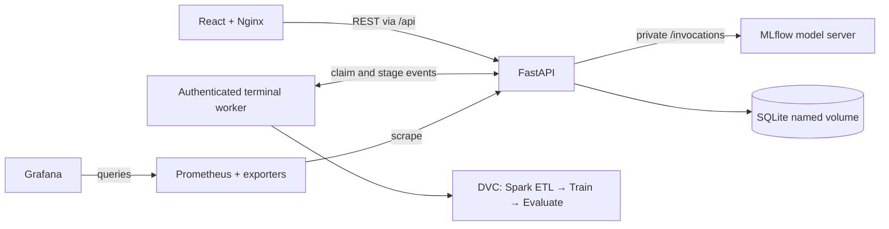

# AIOpsDesk

**Local IT ticket triage and an AIOps lifecycle demonstration for DA3408.**

AIOpsDesk reads an IT support ticket's subject and description and suggests a **category, priority and support team**. It explains influential words, flags low-score recommendations for human review, and records corrections without changing the original prediction.

The project uses a small synthetic dataset to demonstrate how data preparation, training, serving, monitoring and controlled updates fit together on one CPU-only machine. It does not diagnose or repair incidents.

Read the [complete experiment report](report.md), or its [PDF version](report.pdf), for the completed implementation, methods and results.

## Contents

- [Implemented features](#implemented-features)
- [Architecture and tools](#architecture-and-tools)
- [Repository structure](#repository-structure)
- [Dataset and final results](#dataset-and-final-results)
- [Run an initialized installation](#run-an-initialized-installation)
- [Set up a fresh checkout](#set-up-a-fresh-checkout)
- [Work with the pipeline](#work-with-the-pipeline)
- [Tests and evidence](#tests-and-evidence)
- [Documentation](#documentation)
- [What belongs in Git](#what-belongs-in-git)
- [Scope and limitations](#scope-and-limitations)

## Implemented features

- **Ticket analysis:** separate category and priority classifiers, versioned team routing, finite model scores and manual-review warnings.
- **Explanations:** signed TF-IDF word/phrase contributions contrasting the prediction with its strongest alternative. An explanation failure does not discard successful inference.
- **Three roles:** viewers inspect their own history; operators submit corrections; maintainers review feedback and manage pipeline jobs.
- **Audited feedback:** independently reviewed labels, pending/approved/rejected states, reasons and reviewer timestamps. Self-review and repeated decisions are blocked.
- **Pipeline console:** actual Spark ETL, training and evaluation stages, counts/timings, DVC reuse, a single-job guard, running cancellation and linked retries.
- **Controlled model changes:** immutable approved-feedback snapshots, a separate retraining candidate, promotion rejection and an explicit model/policy switching and rollback exercise.
- **Operations:** independent Docker services, persistent SQLite storage, Prometheus/Grafana, HTTP probes and alerts, host metrics and timestamped report metrics.
- **Reproducibility:** pinned source data, grouped splits, Git/DVC lineage, MLflow experiments/serving/Projects, local CI and a final restore drill.
- **KServe exercise:** one real local InferenceService, with readiness and inference-parity verification. The cluster runs separately from the main application.

## Architecture and tools



| Tool | Role in this project |
| --- | --- |
| React + Vite | Independent frontend; Vite handles development and production builds. |
| Nginx | Serves the compiled UI and proxies `/api` to FastAPI. |
| FastAPI + Pydantic | Authentication, request/output validation, policy, persistence and lifecycle endpoints. |
| scikit-learn | TF-IDF and balanced Logistic Regression, with a majority baseline for comparison. |
| Spark | Bounded local ETL and Parquet output verified against Python preparation. |
| Ray | Six small validation trials to select regularization settings. |
| Git + DVC | Code/configuration history and separately versioned data/model artifacts. |
| MLflow | Experiment tracking, self-contained pyfunc serving bundles and a Projects entry point. |
| Docker Compose | Main local deployment with separate UI, API, model and monitoring services. |
| Prometheus + Grafana | Service metrics, probes, alerts, host resources and saved-report freshness. |
| Minikube + KServe | Separate single-node model-serving exercise. |

The model server and MLflow tracking server are **different processes**. Prediction uses the packaged model and continues when tracking is stopped. Spark, Ray and Kubernetes are not kept running during ordinary application use.

## Repository structure

```text
.
├── src/                  # API, auth, history, feedback, explanations and job state
├── frontend/             # React UI, Vite configuration and npm lockfile
├── scripts/              # Data, training, packaging, worker and verification commands
├── configs/              # Labels, model settings, review/promotion/drift policies
├── deploy/
│   ├── docker/           # Dockerfiles, runtime requirements, base-image pins, Nginx
│   ├── k8s/              # Minikube/KServe versions, configuration and model manifest
│   └── releases/         # Preserved release records and exercise/rollback overrides
├── monitoring/           # Prometheus rules, exporters and provisioned Grafana panels
├── tests/                # API, job-state and numerical explanation tests
├── docs/                 # Exactly five required PDFs and five editable Markdown sources
├── reports/              # Measured results, checks, provenance and restore records
├── reproducibility/      # Small bundled DVC store for restoring a fresh clone
├── evidence/             # Screenshots and selected execution/failure/recovery logs
├── data/                 # Git-tracked provenance and DVC pointers
├── artifacts/            # DVC pointers for fitted models and serving bundles
├── compose.yaml          # Application and optional observe profile
├── dvc.yaml / dvc.lock   # Reproducible Spark → train → evaluate stages
├── MLproject             # MLflow Projects entry point for the same DVC workflow
├── report.md / report.pdf # Complete experiment report and requirement coverage
└── requirements.txt      # Tested host training/development package versions
```

`data/` and `artifacts/` contain restored files in a working installation, but their datasets and model binaries are **not uploaded to Git**. Git stores the small DVC pointers and provenance. A compressed DVC object store is included under `reproducibility/`, so a fresh clone can restore the objects without a separate download.

The scripts include the original preparation/experiment steps as well as final verification commands. Those files are retained to reproduce the recorded work. See the [experiment report](report.md) and [evidence guide](evidence/README.md) for the purpose of each evidence group.

## Dataset and final results

**Source:** [Console-AI/IT-helpdesk-synthetic-tickets](https://huggingface.co/datasets/Console-AI/IT-helpdesk-synthetic-tickets). The recorded revision, raw SHA-256 and declared MIT dataset license are in [source.json](data/metadata/source.json).

- 500 raw synthetic tickets; 409 retained after excluding unsupported labels.
- Categories: **Software, Account, Network, Security**.
- Priorities: **Medium, High**.
- Fixed grouped split: **247 train / 81 validation / 81 test**, seed 42.
- Model input: **subject and description only**.
- Models: word TF-IDF, 1–2 grams, up to 5,000 features, followed by balanced Logistic Regression. Validation selected `C=2.0` for category and `C=0.5` for priority.

### Frozen held-out test set

| Task | Accuracy | Macro-F1 | Majority baseline macro-F1 |
| --- | ---: | ---: | ---: |
| Category | 0.7778 | 0.7396 | 0.1811 |
| Priority | 0.8765 | 0.8742 | 0.3520 |

The final test has **81 tickets**. At the fixed `0.60` review thresholds, **23 met both thresholds and 58 required review**. Scores are uncalibrated model preferences, not guaranteed probabilities of correctness.

### Other verified results

| Check | Recorded outcome |
| --- | --- |
| Automated suite | **41 passed**, zero failures/errors/skips |
| Short performance demonstration | 20 requests, concurrency 2, zero failures, **25.25 ms p95** |
| Final DVC restore | **53 files** matched across **11 declared output roots** |
| Startup rehearsal | Eight containers running, saved account/history accessible |
| Monitoring | Ten Prometheus targets up; four HTTP probes successful |
| KServe | Ready InferenceService; all 81 validation predictions matched the local bundle |

The performance run lasted about **0.203 seconds**. Its observed 98.58 requests/s describes that short workload; it is not a sustained-capacity claim. These synthetic-data results demonstrate the concepts and workflow, not industrial generalization.

Details and per-class support: [final evaluation](reports/final_test_evaluation.json), [performance](reports/performance_check.json), [final restore](reports/final_restore_check.json), [startup](reports/final_startup_check.json).

## Run an initialized installation

Run from the repository root. This assumes the local images and persistent application volume already exist:

```bash
docker compose --profile observe up -d --wait --wait-timeout 180
docker compose --profile observe ps
```

| Service | Local URL |
| --- | --- |
| Application | http://127.0.0.1:3002 |
| API documentation | http://127.0.0.1:8000/docs |
| API readiness | http://127.0.0.1:8000/health/ready |
| Grafana | http://127.0.0.1:3001 |
| Prometheus | http://127.0.0.1:9090 |
| Optional MLflow tracking | http://127.0.0.1:5000 |

The model listens privately at `model:5001`. Exporter ports are also private. Omit `--profile observe` to start only the application services.

Current identity: **model `candidate-001`, policy `policy-001`**. The image `aiopsdesk-model:candidate-001-explained` adds the `explanations-001` serving capability without retraining the fitted classifiers.

Stop the project while retaining its storage:

```bash
docker compose --profile observe stop
```

The application database is in the external volume **`aiopsdesk_app_data`**. The old host `state/app/` database is a separate copy. Do not delete volumes or overwrite the database during routine startup.

## Set up a fresh checkout

The tested host used **Python 3.14.4, Java 17, Docker/Compose, and Node 24**. Java is needed for Spark; Node is needed for host frontend development, while the frontend Dockerfile supplies its own build environment. Keep heavy training and Minikube in separate phases.

### 1. Create the Python environment

```bash
python3.14 -m venv .venv
source .venv/bin/activate
python -m pip install -r requirements.txt
```

The existing development environment was named `AIops`; a fresh environment can use another name.

### 2. Restore DVC data and models

This repository includes a small compressed DVC object store containing the dataset and trained model artifacts. After installing the Python requirements, restore them with:

```bash
python scripts/restore_submission.py
```

The helper verifies the backup checksum, extracts it under ignored `state/`, configures a checkout-local DVC remote, runs `dvc pull` and checks all **53 restored data/model files** against their expected hashes. Existing default remote configuration is preserved; fresh clones use the bundled remote by default. No separate data/model download link is needed.

The CSVs, Parquet outputs and fitted bundles remain DVC-owned. The included backup is a small distribution copy for this completed project. Dependency and Docker base-image downloads still require internet access unless cached locally.

### 3. Build the application images

The model bundle must be restored before its image is built.

```bash
docker build --build-arg PYTHON_IMAGE="$(cat deploy/docker/python-base.txt)" -f deploy/docker/Dockerfile.api -t aiopsdesk-api:dev .
docker build --build-arg PYTHON_IMAGE="$(cat deploy/docker/python-base.txt)" -f deploy/docker/Dockerfile.model-explained -t aiopsdesk-model:candidate-001-explained .
docker build --build-arg NODE_IMAGE="$(cat deploy/docker/node-base.txt)" --build-arg NGINX_IMAGE="$(cat deploy/docker/nginx-base.txt)" -f deploy/docker/Dockerfile.frontend -t aiopsdesk-frontend:dev .
docker image tag aiopsdesk-api:dev aiopsdesk-reports:monitoring-001
```

For the monitoring profile, fetch the pinned official images:

```bash
docker pull "$(cat deploy/docker/prometheus-image.txt)"
docker pull "$(cat deploy/docker/grafana-image.txt)"
docker pull "$(cat deploy/docker/blackbox-image.txt)"
docker pull "$(cat deploy/docker/node-exporter-image.txt)"
```

### 4. Start and initialize accounts

```bash
docker volume create aiopsdesk_app_data
docker compose --profile observe up -d --wait --wait-timeout 180
```

For a **new empty database only**, create the three accounts inside the API container. Skip this if the accounts already exist:

```bash
docker compose exec api python -c '
from getpass import getpass
from src.auth import create_user
for role in ("viewer", "operator", "maintainer"):
    create_user(role, getpass(f"New {role} password: "), role)
'
```

Enter private passwords of at least ten characters. No account passwords are shipped in this repository. Grafana has its own separate administrator account.

## Work with the pipeline

### Browser-managed jobs

Activate the host environment and start the worker in a separate terminal:

```bash
python -m scripts.pipeline_worker --once
```

Sign in to the UI as maintainer, open **Pipeline**, enter a reason and start a job. `--once` processes one job and exits. Unchanged stages show **Reused**; selecting **Rebuild all stages** records actual execution. Running cancellation remains requested until the worker stops its processes. Retry creates a new linked job.

The browser workflow is **Spark ETL → Train → Evaluate**. It uses the versioned dataset/splits and selected settings. It does not automatically ingest feedback, repeat Ray tuning or deploy a model.

### Ray dashboard with embedded Grafana

Grafana on port 3001 also hosts Ray's generated dashboards. Sign in to Grafana in a separate tab first, then use the Ray dashboard on port 8265. Grafana login remains enabled.

From the activated project environment, stop an idle previous Ray instance before starting this helper:

```bash
ray stop
bash scripts/start_ray_dashboard.sh
```

The helper points Ray at Grafana 3001 and Prometheus 9090, starts a small authenticated Ray instance and installs its generated dashboards/metric targets. Ray automatically chooses a non-loopback node address so Docker's Prometheus can reach its metrics; its browser dashboard stays bound to loopback. If prompted by Ray, run `ray get-auth-token` and enter the token locally.

Ray's dashboards and targets under `monitoring/ray/` are generated locally and ignored by Git. When finished:

```bash
ray stop
python scripts/configure_ray_monitoring.py --clear
```

Application monitoring continues normally. This dashboard helper does not rerun the six-trial model search or rewrite model-selection reports.

### Terminal workflows

| Purpose | Command / entry point |
| --- | --- |
| Local CI: syntax, tests, DVC reproduction and validation gate | `python scripts/ci.py` |
| Inspect/reproduce the pipeline | `dvc dag evaluate` / `dvc repro evaluate` |
| Start optional tracking | `bash scripts/start_mlflow.sh` |
| Run an MLflow Project | `MLFLOW_TRACKING_URI=http://127.0.0.1:5000 mlflow run . --env-manager local --experiment-name AIOpsDesk-project -P force=1` |
| Inspect DVC state / back up objects | `dvc status` / `dvc push` |
| Final restored-checkout comparison | `python scripts/verify_final_restore.py /path/to/restored-checkout` |

MLflow tracking must be running for tracked experiments and `mlflow run`. The model server does not need tracking for prediction. Keep the terminal worker stopped during separate manual reproduction.

The initial data scripts, Ray search, approved-feedback export/training, packaging and promotion checks remain under `scripts/`. Their measured outputs are in `reports/`. The feedback candidate used one approved **synthetic** category correction and was rejected by the promotion policy. The separately labelled switch/rollback exercise tested deployment mechanics, not improved model quality.

## Tests and evidence

```bash
python -m pytest tests -q
npm --prefix frontend ci
npm --prefix frontend run lint
npm --prefix frontend run build
```

The test suite covers validation, authentication, ownership, immutable review, worker claims/order, single-job concurrency, cancellation and explanation algebra/fallback. Browser workflows were exercised manually; no automated browser-test claim is made.

- [Screenshot folder](evidence/Screenshots/) — supplied screenshots are retained unchanged.
- [Evidence guide](evidence/README.md) — execution, reuse, cancellation and recovery records.
- [Report guide](reports/README.md) — where to find final results and historical checks.
- [Complete experiment report and coverage assessment](report.md).

Monitoring combines API/model-call metrics, online HTTP probes, host CPU/memory/disk and saved pipeline/CI/drift summaries. Scraping a report does not rerun its analysis: **read its age**. The last application drift report was `insufficient_data` with 13 rows. The 20 performance-demo tickets are marked artificial traffic in history.

## Documentation

| Required document | PDF | Editable source |
| --- | --- | --- |
| Architecture and component diagram | [Architecture](docs/architecture.pdf) | [Markdown](docs/architecture.md) |
| High-level design and rationale | [HLD](docs/hld.pdf) | [Markdown](docs/hld.md) |
| Low-level design and API contracts | [LLD](docs/lld.pdf) | [Markdown](docs/lld.md) |
| Test plan, cases and results | [Test plan](docs/test-plan.pdf) | [Markdown](docs/test-plan.md) |
| Nontechnical user instructions | [User manual](docs/user-manual.pdf) | [Markdown](docs/user-manual.md) |

The complete dataset/model description, evidence map and limitations are in [report.md](report.md). The live API exposes interactive contracts at http://127.0.0.1:8000/docs and JSON at http://127.0.0.1:8000/openapi.json. `docs/` intentionally contains only the ten files above.

The builder preserves Markdown sources and the README. Keep its PDF-only dependency separate from the training environment:

```bash
python -m venv state/docs-venv
state/docs-venv/bin/python -m pip install reportlab==4.4.9
state/docs-venv/bin/python scripts/build_project_docs.py --repo .
```

That command regenerates the five design/manual PDFs and root `report.pdf`. To rebuild only the experiment report, add `--report-only`. It never trains, evaluates models or restarts services.

## What belongs in Git

**Included:** source, configs, Docker/Kubernetes files, dependency locks, DVC pointers, the five PDFs and sources, measured reports, screenshots and selected successful/failure/recovery evidence.

**Excluded:** virtual environments, npm dependencies/build output, Python caches, `.env` files, live SQLite databases, sessions/password state, MLflow runtime storage, DVC cache and restored dataset/model binaries. The small `reproducibility/dvc-store.tar.gz` distribution backup is intentionally included in Git; other submission archives remain outside the repository.

The DVC object store contains reproducible data/model objects. It does not contain the live application accounts/history or historical tracking-server database. Restore or initialize those separately.

## Scope and limitations

This is a completed **small educational implementation**, with explicit simplifications from the original blueprint. It uses a synthetic dataset, a small held-out sample and uncalibrated scores. Retraining/release actions are controlled demonstrations rather than unattended production automation. Training/Projects use the local host environment. KServe deploys the model only in a separate phase.

TLS/encrypted-storage verification, persistent prediction idempotency, batch prediction, scheduled drift/retraining, per-container resource collection, automatic orphan-job recovery and sustained-capacity/browser automation tests are outside the demonstrated scope. The [project report](report.md) describes the implemented workflows and measured results.

## Prepare the final Git submission

The working tree contains the submission cleanup and new report. Review and commit it before pushing:

```bash
git status --short
git diff --check
git add -A
git diff --cached --stat
git commit -m "Prepare final AIOpsDesk submission and experiment report"
git push origin main
```

Push code, the report, the ten design/manual files, machine-readable evidence and supplied screenshots. Include `reproducibility/dvc-store.tar.gz` and `scripts/restore_submission.py`: they let evaluators restore the data/model objects from the repository alone. Keep live accounts, databases, local credentials and caches out of Git. `reports/submission_check.json` records the final source audit; its checks do not claim that every broader blueprint feature was implemented. This preparation does not commit or push on your behalf.
