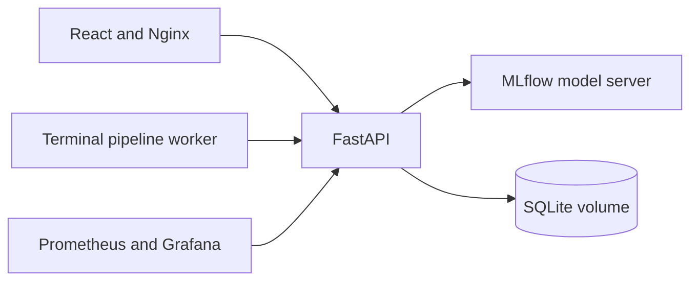

# AIOpsDesk - Architecture

DA3408 local AI application | As-built documentation

Reviewed for submission using the recorded 2026-11-11 measurements and completed handover checks. Evidence paths and scope are consolidated in the root report.md; document hashes are recorded in reports/documentation_check.json.

## 1. Problem and boundary

AIOpsDesk assists an IT support operator by recommending one of four categories, one of two supported priority labels and a support team. The operator remains responsible for reviewing the recommendation. A viewer can submit a ticket, an operator can propose corrections, and a maintainer can review corrections and manage local pipeline jobs.

All compute and storage run on one local machine. The dataset was downloaded once from a pinned public revision. There is no paid inference API or cloud runtime dependency. Compose is the main application deployment; Kubernetes/KServe was a separate, stopped-after-use course exercise.

## 2. Architecture diagram

Solid arrows show the main prediction and persistence path. The terminal worker communicates with the API and executes offline commands in the repository. Prometheus observes the online services and exporters; it does not execute training or drift analysis.

## 3. Components and ports

| Component | Access | Responsibility |
| --- | --- | --- |
| React + Nginx | 127.0.0.1:3002 | Ticket UI; /api reverse proxy to FastAPI |
| FastAPI | 127.0.0.1:8000 | Authentication, validation, routing, history, feedback, job API |
| MLflow model server | model:5001; private | Original fitted pipelines plus explanation-enabled bundle |
| Prometheus | 127.0.0.1:9090 | 15-second scraping and availability rules |
| Grafana | 127.0.0.1:3001 | Provisioned service, host and report panels |
| Blackbox Exporter | blackbox:9115; private | HTTP probes of frontend, API, model and Grafana |
| Node Exporter | node-exporter:9100; private | Host CPU, memory, root filesystem and load |
| Report exporter | reports-exporter:9108; private | Existing CI, pipeline and drift summaries and age |
| MLflow tracking | 127.0.0.1:5000; optional | Experiments and artifacts; started separately when needed |
| Terminal worker | Authenticated HTTP client | Runs fixed DVC stages in the AIops environment |

## 4. Prediction path

1. A signed-in user enters a subject and opening description in the independent React UI.
2. Nginx forwards /api requests to FastAPI. The bearer token is held in browser memory.
3. FastAPI validates the input and calls the private MLflow /invocations endpoint, with a three-second model-call timeout.
4. The pyfunc bundle normalizes/redacts text, predicts category and priority, and computes bounded signed word/phrase contributions.
5. FastAPI validates model identity and scores, derives the support team from policy, and applies review thresholds.
6. The API stores the redacted input, original result, owner, timestamp, model version and policy version in SQLite before returning success.
7. History displays that saved result. A feedback review records a separate decision and does not rewrite the prediction.

## 5. Offline and control paths

Git versions code/configuration and small reports. DVC versions dataset directories, model artifacts and serving bundles, with a local remote outside the checkout. A grouped split manifest is reused by Spark-based training. Ray performed six bounded parameter trials and shut down. MLflow tracked experiments and packages; an MLproject entry point reproduced the DVC pipeline using the local environment.

The maintainer creates a job through the API. SQLite enforces one queued/running/cancel-requested job. A separate terminal worker claims it with a temporary secret and records ordered stage starts, finishes, counts and durations. Only fixed DVC commands are executed. Cancellation stops the subprocess group before the worker records a terminal result.

## 6. Storage and deployment isolation

- Current model: candidate-001; policy: policy-001; explanation capability bundle: explanations-001.
- Serving bundle: artifacts/serving/candidate-001-explained. Fitted classifier bytes are unchanged from candidate-001.
- Application database: /app/state/app/aiops.db in the external named volume aiopsdesk_app_data. The old host state/app database is a separate copy.
- Tracking metadata/artifacts: state/mlflow, managed by the optional host tracking server.
- API/model network: app_internal. Published loopback services also use app_access. The private model/exporters have no host-published ports.
- Prometheus/Grafana use named volumes; application/model containers have bounded resources and logs, nonroot users, and read-only root filesystems with explicit writable locations.

## 7. Evidence and interpretation

The HTTP/local-bundle comparison checked all 81 validation inputs. The KServe report checked the same number and recorded a Ready InferenceService. Container persistence, real pipeline execution, cache reuse, active cancellation/retry and model switch/rollback have separate saved reports.

Held-out results were calculated only after selection and review policy were frozen. Earlier test_set_used=false flags refer to their own earlier runs; the final test report correctly records test_set_used=true.

Final handover was also exercised: all 53 DVC-owned files across 11 output roots matched in a clean restored checkout. The normal application restarted with eight containers, saved account/history access, ten Prometheus targets and four successful HTTP probes. reports/final_restore_check.json and reports/final_startup_check.json preserve the actual results.

Primary evidence: src/api.py and its included routers; compose.yaml; dvc.yaml; reports/final_test_evaluation.json; reports/kserve_check.json; reports/release_switch_check.json; reports/pipeline_recovery_check.json.

For the full implementation boundary, see the root report.md, section 12. The source blueprint is a plan; this documentation describes the smaller implementation actually exercised.
