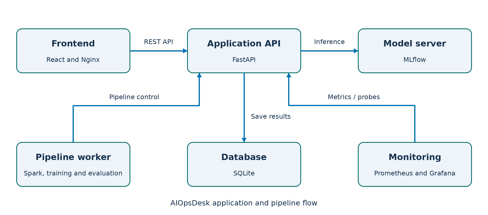

# AIOpsDesk - Project Experiment Report

## 1. Project overview and architecture

AIOpsDesk is a local IT support application that reads a ticket's subject and description and recommends a category, priority and support team. We built it with a small synthetic dataset and simple machine-learning methods to understand how data processing, training, deployment, monitoring and model updates work together.

The completed application supports ticket analysis, word-level explanations, prediction history, reviewed corrections and a live training-pipeline console. All computation runs locally on the CPU.

The frontend sends requests through Nginx to FastAPI. The API validates the ticket, checks the signed-in user's permissions and calls the separate model server. It then applies the routing and review policy, saves the result in SQLite and returns it to the interface. A terminal worker executes training jobs requested by a maintainer.

| Component | Work completed |
| --- | --- |
| React, Vite and Nginx | Built and served the independent frontend with an API reverse proxy. |
| FastAPI and Pydantic | Implemented validated prediction, login, history, feedback and pipeline interfaces. |
| scikit-learn | Trained separate category and priority classifiers using TF-IDF and Logistic Regression. |
| SQLite | Stored users, sessions, predictions, feedback reviews and pipeline jobs. |
| Spark | Processed the ticket data and validated the Parquet output. |
| Ray | Ran six small parameter-selection trials. |
| Git and DVC | Versioned code, configurations, datasets and model artifacts. |
| MLflow | Tracked experiments, packaged models, served predictions and ran the training project. |
| Docker Compose | Ran separate application and monitoring containers. |
| Prometheus and Grafana | Collected metrics and displayed service, host and workflow information. |
| Minikube and KServe | Deployed and tested the model in a local Kubernetes environment. |

<!-- PAGE_BREAK -->

## 2. Dataset preparation and splitting

We downloaded a dataset containing 500 synthetic IT support tickets. The acquisition checks examined required fields, missing values, duplicate IDs and duplicate subject/description pairs. The required values were present, and the initial duplicate checks passed.

We retained four ticket categories and two priority classes. Rows outside these supported labels were separated with exclusion reasons. The cleaned dataset contained 409 tickets: 91 rows were excluded, consisting of 88 unsupported-category rows and three additional unsupported-priority rows.

| Retained label | Total | Train | Validation | Test |
| --- | --- | --- | --- | --- |
| Software | 230 | 138 | 46 | 46 |
| Account | 71 | 43 | 14 | 14 |
| Network | 66 | 40 | 14 | 12 |
| Security | 42 | 26 | 7 | 9 |
| Medium priority | 227 | 140 | 43 | 44 |
| High priority | 182 | 107 | 38 | 37 |

The model uses only the subject and description. Ticket identifiers, requester email, target labels and split information are excluded from the input features. Preparation trims text, normalizes whitespace and replaces email patterns before storing or processing the text.

### Grouped data split

We created fixed training, validation and test partitions using random seed 42. The partitions contained 247, 81 and 81 tickets respectively, approximating a 60/20/20 split.

To keep closely related tickets together, we compared description token sets with Jaccard similarity and grouped pairs with similarity of at least 0.85. This identified seven similar pairs and produced 405 groups. The largest group contained four tickets.

We checked that ticket IDs and detected groups did not cross partition boundaries, every retained ticket belonged to one partition and all supported labels appeared in every partition. The training set was used to fit model features and classifiers; validation was used for parameter selection; the held-out test set was used for the final evaluation.

### Spark processing

We implemented the same processing in Spark using two local worker threads and a 1 GiB driver budget. Spark wrote the retained data as Parquet. A Unicode whitespace difference in one ticket was resolved with Unicode-aware normalization.

All 409 processed rows matched the Python preparation output, and reading the Parquet data back produced matching values. The measured Spark startup time was 1.875 seconds. ETL, validation and writing took 4.100 seconds, corresponding to 121.96 input rows per ETL second. The Spark session stopped when processing completed.

<!-- PAGE_BREAK -->

## 3. Model development and experiment tracking

We trained two independent text-classification pipelines: one for category and another for priority. Each pipeline combines the subject and description, converts the text into TF-IDF features and applies Logistic Regression.

| Model setting | Configuration |
| --- | --- |
| Text features | Word unigrams and bigrams |
| Maximum TF-IDF features | 5,000 |
| Minimum document frequency | 2 |
| Class weighting | Balanced |
| Maximum training iterations | 1,000 |
| Random seed | 42 |

The vocabulary and model parameters were fitted on training data. Balanced class weights addressed the unequal category counts. A majority-class classifier provided a basic comparison for each target.

### Initial validation comparison

| Target / validation model | Accuracy | Macro-F1 |
| --- | --- | --- |
| category / majority | 0.5679 | 0.1811 |
| category / logistic_regression | 0.7284 | 0.7139 |
| priority / majority | 0.5309 | 0.3468 |
| priority / logistic_regression | 0.9012 | 0.9005 |

### Ray parameter search

We used Ray to compare three regularization values for each target: C=0.5, C=1.0 and C=2.0. The search allocated two CPUs and ran one trial at a time, producing six trials in total.

| Target | C | Validation accuracy | Validation macro-F1 | Fit time (s) |
| --- | --- | --- | --- | --- |
| category | 0.5 | 0.7037 | 0.6929 | 0.0730 |
| category | 1.0 | 0.7284 | 0.7139 | 0.0366 |
| category | 2.0 | 0.7531 | 0.7297 | 0.0386 |
| priority | 0.5 | 0.9012 | 0.9005 | 0.0367 |
| priority | 1.0 | 0.9012 | 0.9005 | 0.0311 |
| priority | 2.0 | 0.8889 | 0.8878 | 0.0288 |

Category selected C=2.0, producing validation accuracy 0.7531 and macro-F1 0.7297. Priority selected C=0.5, producing validation accuracy 0.9012 and macro-F1 0.9005. The priority scores tied with C=1.0, and the selection rule preferred the smaller C.

We used MLflow to track the baseline comparisons, Ray trials and model-packaging runs. Parameters, evaluation metrics, configurations and artifacts were logged. The selected pipelines were saved, loaded again and checked for matching predictions. Ray shut down after the search.

<!-- PAGE_BREAK -->

## 4. Final evaluation and prediction explanations

After selecting the models and fixing the review policy, we evaluated the serving model on the held-out set of 81 tickets.

| Test metric | Category | Priority |
| --- | --- | --- |
| Accuracy | 0.7778 | 0.8765 |
| Macro-F1 | 0.7396 | 0.8742 |
| Weighted-F1 | 0.7749 | 0.8757 |
| Balanced accuracy | 0.7144 | 0.8713 |
| Majority baseline macro-F1 | 0.1811 | 0.3520 |
| Log loss | 0.6838 | 0.4892 |

| Task / class | Test support | Precision | Recall | F1 |
| --- | --- | --- | --- | --- |
| category / Account | 14 | 0.6154 | 0.5714 | 0.5926 |
| category / Network | 12 | 0.8182 | 0.7500 | 0.7826 |
| category / Security | 9 | 0.8571 | 0.6667 | 0.7500 |
| category / Software | 46 | 0.8000 | 0.8696 | 0.8333 |
| priority / High | 37 | 0.9091 | 0.8108 | 0.8571 |
| priority / Medium | 44 | 0.8542 | 0.9318 | 0.8913 |

### Classification results

The category model correctly classified 63 of 81 tickets. Software had the strongest category recall. Six Account tickets were classified as Software.

The priority model correctly classified 71 of 81 tickets. It classified 30 High tickets and 41 Medium tickets correctly. Seven High tickets were classified as Medium, while three Medium tickets were classified as High.

### Review policy

We set both category and priority score thresholds to 0.60. A ticket receives a manual-review warning if either score falls below its threshold. On the test set, 23 tickets met both thresholds and 58 required review.

### Word and phrase explanations

We added explanations to show which text features supported the predicted class or its strongest alternative. Each contribution is calculated from the TF-IDF feature value and the difference between the relevant Logistic Regression coefficients.

The explanation includes the intercept, five displayed word/phrase contributions, the contribution of omitted terms and the reconstructed decision margin. Binary priority predictions use the appropriate coefficient sign. We verified explanations for all 81 validation tickets for both targets: predicted classes matched and all 162 margins reconstructed correctly.

The API validates the explanation before returning it, and the frontend displays the supporting terms. When an explanation is unavailable or invalid, the valid classification result is retained with an explanation-unavailable status.

<!-- PAGE_BREAK -->

## 5. Application, authentication and user interface

We built an independent React interface with Analyse, History, Feedback and a maintainer Pipeline screen. Vite handles development and production builds. Nginx serves the compiled application and forwards API requests to FastAPI.

The interface displays ticket categories, priorities, support teams, model scores, review warnings and explanations. Colors are accompanied by labels, symbols and borders so users can identify states from more than color alone.

### User roles

| Role | Implemented access |
| --- | --- |
| Viewer | Submit tickets and inspect their own prediction history. |
| Operator | Analyse tickets, inspect prediction history and submit corrections. |
| Maintainer | Review feedback and manage pipeline jobs, in addition to operational access. |

Passwords are stored using Argon2 hashing. Login creates a random bearer token, and the database stores its digest. Sessions expire after one hour and can be invalidated by logout. The browser keeps the token in memory.

### Ticket analysis and history

The prediction API requires a nonempty subject and description. It trims surrounding whitespace, rejects unexpected fields and limits their combined length to 5,000 characters. Returned labels, scores and model identity are validated before the result is saved.

A versioned policy maps the category to a support team:

| Category | Support team |
| --- | --- |
| Software | Application Support |
| Account | Identity Support |
| Network | Network Support |
| Security | Security Support |

SQLite stores the redacted input, original prediction, owner and model/policy versions. The history screen retrieves these stored results with cursor-based pagination. Viewers can access only their own records; operators and maintainers can inspect operational history.

### Feedback review

Operators can propose a corrected category, priority or both, with a reason. Feedback begins as pending. A maintainer can approve or reject it, and the system preserves the reviewer and decision details. Self-review and a second decision on the same correction are rejected. Feedback decisions are stored separately, preserving the original prediction.

### API behavior

We implemented prediction, session, history, feedback, pipeline-control and worker interfaces. Health endpoints check liveness and readiness. The API returns controlled responses for missing authentication, insufficient permission, unknown records, conflicting actions, invalid input, model failures, storage failures and timeouts. Email patterns are redacted before prediction text is persisted.

<!-- PAGE_BREAK -->

## 6. Reproducible pipeline and model serving

### Git, DVC and MLflow Projects

We used Git for application code, configuration and experiment scripts. DVC manages datasets, processed outputs, split assignments, trained models and serving bundles through a separate local object store.

The DVC pipeline has three stages: Spark ETL, training and evaluation. Training uses the fixed assignments and selected model settings. Evaluation checks the validation predictions and quality gate. Unchanged inputs allow DVC to reuse completed stages.

We also created and executed an MLflow Projects entry point for this pipeline. It reproduced Spark processing, training and validation in the local Python environment, with the validation quality gate passing.

### Live pipeline console

A maintainer can start a pipeline job from the frontend. An authenticated terminal worker claims the job and runs the configured stages. The application displays state transitions, row counts, duration and outcomes.

SQLite enforces one active job. Worker events follow the required stage order, and each job retains its request reason and retry relationship. A configured stage timeout bounds execution.

| Executed stage | Duration | Rows processed |
| --- | --- | --- |
| Spark ETL | 10.16 s | 500 input, 409 retained, 91 rejected |
| Training | 4.35 s | 247 training tickets |
| Evaluation | 1.27 s | 81 validation tickets |

We exercised a browser-launched run, reuse of unchanged stages, cancellation during Spark and a linked retry. Cancellation stopped the active command and skipped later stages. The retry completed all stages and passed its quality gate.

### Local continuous integration

The CI command checks Python syntax, runs automated tests, reproduces the DVC pipeline and applies the validation gate. We introduced a controlled test failure and verified that it blocked downstream pipeline execution. After recovery, CI completed successfully.

### Independent model serving

We packaged both fitted pipelines in an MLflow pyfunc bundle and served it through HTTP. Predictions for all 81 validation tickets matched direct local predictions. We also stopped MLflow tracking and confirmed that the packaged model continued serving predictions.

The explanation-enabled bundle retained the fitted classifiers while adding word/phrase explanations. The application used model candidate-001 with policy-001 throughout normal operation.

<!-- PAGE_BREAK -->

## 7. Drift detection, feedback retraining and rollback

### Input drift checks

We created a reference from the 247 training tickets, with a vocabulary of 1,616 terms. Drift checks compare text-length distributions using KS distance and measure the fraction of unfamiliar tokens. A batch requires at least 30 tickets, and the configured threshold for either signal is 0.30.

| Batch | Rows | KS distance | Unknown fraction | Decision |
| --- | --- | --- | --- | --- |
| Validation control | 81 | 0.0791 | 0.0856 | No drift |
| Deliberate synthetic shift | 81 | 0.9960 | 1.0000 | Drift detected |
| Recent application tickets | 13 | Not evaluated | Not evaluated | Insufficient data |

The validation batch stayed below both thresholds. A deliberately shifted batch activated both signals. The application-history batch correctly returned insufficient data because it contained fewer than 30 tickets.

### Approved-feedback retraining

We exported a consistent SQLite backup and created an immutable snapshot of reviewed corrections. The snapshot contained one approved synthetic Network category correction and no priority correction. We checked its integrity and checked for overlapping text with held-out tickets.

The category model was trained on 248 tickets: the original 247 training tickets plus the approved correction. The priority artifact was copied unchanged.

| Feedback-training result | Value |
| --- | --- |
| Added category corrections | 1 |
| Category training rows | 248 |
| Category validation macro-F1 before | 0.7297 |
| Category validation macro-F1 after | 0.7297 |
| Priority artifact | Unchanged |
| Saved/reloaded prediction comparison | Passed |

### Promotion decision

We implemented a promotion gate requiring reviewed operational labels, at least 0.001 improvement in category macro-F1, no accuracy regression and valid artifacts. The synthetic-feedback candidate had zero macro-F1 improvement and did not meet the label-origin requirement. The gate retained the current model.

### Model switching and rollback

We packaged the feedback candidate as a separate serving bundle and built its Docker image. Offline loading succeeded under a nonroot user. In an explicit release-switching exercise, we activated feedback-demo-001 with its matching policy, checked API and frontend readiness, and restored candidate-001 with policy-001. Image identity and application-volume preservation were verified during switching and rollback.

<!-- PAGE_BREAK -->

## 8. Docker deployment, monitoring and KServe

### Container deployment

We containerized the frontend, FastAPI application and MLflow model server as separate services. Python model/API containers run under nonroot users. The model bundle was loaded successfully with networking disabled.

Docker Compose connects the services and uses an external named volume for the SQLite application database. Recreating the API container preserved the existing operator account, prediction ownership, saved result and redacted text.

| Service | Local access |
| --- | --- |
| Application | 127.0.0.1:3002 |
| FastAPI | 127.0.0.1:8000 |
| Grafana | 127.0.0.1:3001 |
| Prometheus | 127.0.0.1:9090 |
| MLflow tracking | 127.0.0.1:5000 when started |
| Model server | Private container network on port 5001 |

### Monitoring

We added Prometheus instrumentation for API/model-call latency, failures, prediction and review counts, scores and database-write failures. Prometheus scrapes the services every 15 seconds, and Grafana displays the collected information.

Blackbox Exporter probes the frontend, API readiness, model server and Grafana. Node Exporter collects host CPU, memory and filesystem metrics. We checked the host memory reading against the operating system's memory information.

A separate exporter exposes saved pipeline, CI and drift states, along with their age. Dashboards show service availability, request behavior, host resources and workflow status.

We stopped the frontend to test availability alerting. Its probe changed to a failed state and the alert activated. Restarting the frontend restored the successful probe and cleared the alert.

The complete application and monitoring deployment ran eight project containers. Following a restart, the existing account and history remained accessible, all ten Prometheus targets were up and all four HTTP probes succeeded.

### Kubernetes and KServe

We started a local Minikube cluster, installed cert-manager and KServe, and deployed the model as a Standard-mode InferenceService. The service became Ready and was accessed through a deployment port-forward.

Health checks returned HTTP 200, and predictions for all 81 validation tickets matched the local model bundle. The Kubernetes exercise ran separately from the normal Compose deployment. We stopped the cluster before resuming the application services.

<!-- PAGE_BREAK -->

## 9. Testing, performance and restoration

### Automated and integration testing

We implemented and ran 41 automated tests. All 41 passed, with zero failures, errors or skipped tests.

The tests cover request validation, authentication, prediction ownership, redacted storage, feedback permissions, immutable reviews, controlled model/storage failures, numerical explanations, worker authorization, stage ordering, concurrent-job exclusion, cancellation and retry.

We also ran component checks against the application workflows:

| Component check | Checks passed |
| --- | --- |
| Sessions and logout | 17 |
| Prediction API | 18 |
| History and ownership | 19 |
| Feedback | 16 |
| Maintainer review | 22 |

These component checks exercised login/logout, valid and invalid predictions, history access, proposed corrections and review decisions. Separate model checks compared HTTP predictions with local predictions, while the pipeline runs executed Spark, training and evaluation.

Frontend lint and the production build passed. Python syntax, Compose configuration and DVC synchronization checks also passed.

### Performance check

We submitted 20 demonstration requests using two concurrent clients. Every request returned a valid response.

| Measurement | Result |
| --- | --- |
| Requests | 20 |
| Concurrent clients | 2 |
| Failed requests | 0 |
| Median latency | 18.36 ms |
| 95th-percentile latency | 25.25 ms |
| Maximum latency | 28.99 ms |
| Total measured duration | 0.203 s |
| Observed throughput for this short run | 98.58 requests/s |

The timing included the client request, response parsing and validation. The short-run acceptance check required zero failures and p95 latency below one second; both conditions passed.

### Data restoration and restart

We restored the DVC-managed data and models into a clean checkout and compared all restored files. All 53 files across 11 managed output directories matched. The local cache and remote store were synchronized.

We then stopped and restarted the application services. The database volume retained accounts and prediction history, the API and frontend returned ready responses, and the monitoring targets recovered successfully.

The completed workflow combines prepared ticket data, selected text classifiers, independent serving, authenticated application screens, reproducible training, human-reviewed feedback, controlled model changes and local monitoring.
